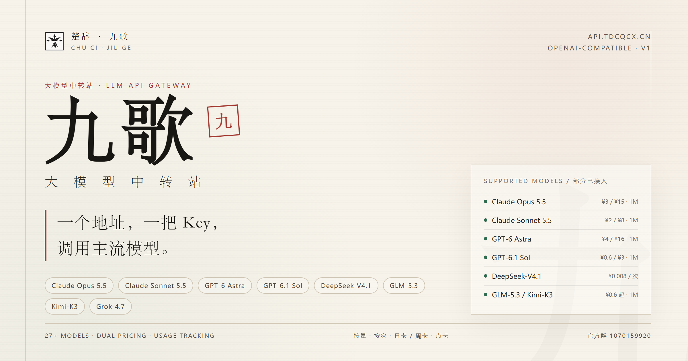
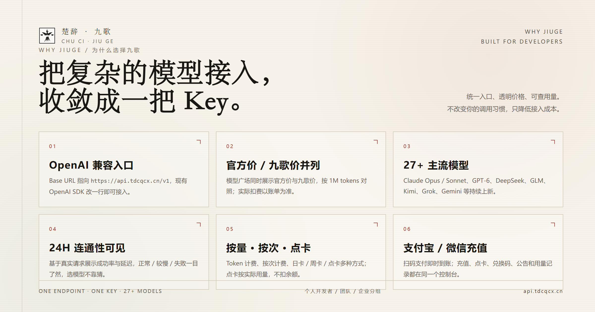
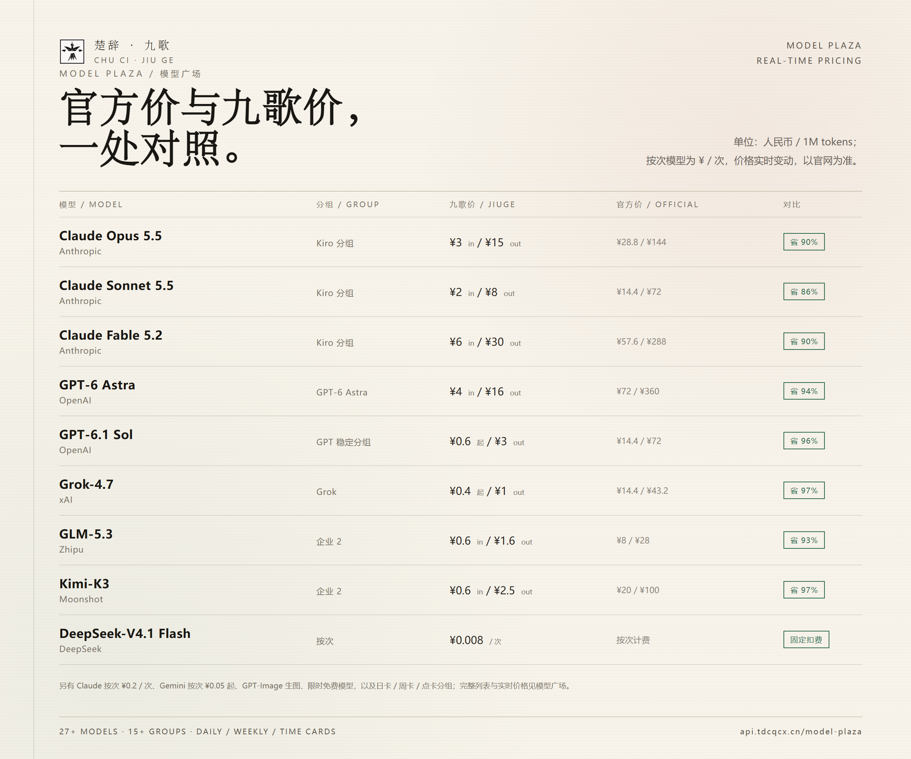
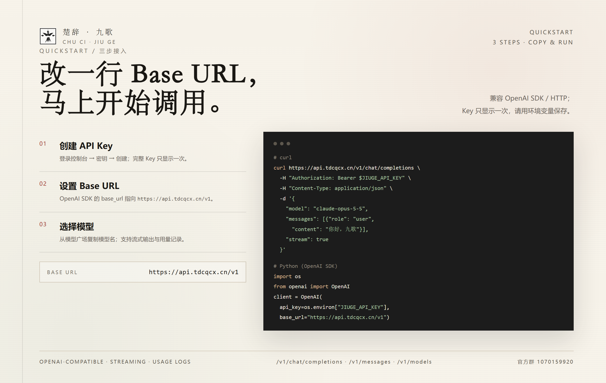

<div align="center">



# JiuGe API · 九歌 API

### One endpoint. One key. All major LLMs.

**LLM API Gateway · OpenAI-Compatible**

[Website](https://api.tdcqcx.cn) · [Model Plaza](https://api.tdcqcx.cn/model-plaza) · [Quickstart](https://api.tdcqcx.cn/guide) · [Sign up](https://api.tdcqcx.cn/register) · [Console](https://api.tdcqcx.cn/dashboard)

[简体中文](README.md) | [English](README.en.md) | [日本語](README.ja.md)


</div>

---

## What is JiuGe API?

**JiuGe API** is a third-party LLM API relay and aggregation service for developers. It brings major model families — OpenAI, Anthropic, Google, DeepSeek, Zhipu, Moonshot, xAI and more — behind **one base URL and one API key**, while keeping the OpenAI SDK workflow you already use.

- **One endpoint:** `https://api.tdcqcx.cn/v1`
- **One key:** switch models without maintaining separate upstream accounts
- **Transparent dual pricing:** official price vs JiuGe price, side by side per 1M tokens
- **Usage tracking:** balance, requests, tokens, cost and per-key usage in one console
- **Flexible billing:** pay-as-you-go, pay-per-request, daily / weekly / time cards, enterprise groups
- **Local payments:** Alipay / WeChat Pay, usually credited instantly

> JiuGe is an independent third-party API relay/aggregation service. It is not affiliated with OpenAI, Anthropic, Google, DeepSeek, Zhipu, Moonshot or xAI. Model names and trademarks belong to their respective owners.

---

## Why JiuGe



| Capability | Details |
|---|---|
| **OpenAI-compatible** | Change `base_url` in the OpenAI SDK; plain HTTP works too |
| **Major model coverage** | Claude Opus / Sonnet / Fable, GPT-6 / 6.1 / 6.2, DeepSeek-V4.1, GLM-5.3, Kimi-K3 / K3.1-Pro, Grok-4.7, Gemini |
| **Official vs JiuGe pricing** | Official price, JiuGe price, savings and cache pricing for each model |
| **24h connectivity** | Success rate and latency based on real requests |
| **Multiple billing modes** | Token-based, per-request, daily card, weekly card, time card |
| **Complete console** | Keys, usage, balance, recharge, cards, redeem codes, announcements, settings |
| **Payments** | Alipay / WeChat Pay scan-to-pay, usually instant |
| **Community** | Official QQ group `1070159920` for support and model updates |

---

## Models & pricing



> Currency: CNY per 1M tokens; per-request models are CNY / request. Prices change with upstream channels and operations. **Always use the live [Model Plaza](https://api.tdcqcx.cn/model-plaza) price.** USD official prices are displayed at 1:7.2.

| Model | Platform / group | JiuGe (CNY / 1M) | Official (CNY / 1M) | Notes |
|---|---|---:|---:|---|
| **Claude Opus 5.5** | Anthropic / Kiro | in 3 · out 15 | in 28.8 · out 144 | ~90% lower |
| **Claude Sonnet 5.5** | Anthropic / Kiro | in 2 · out 8 | in 14.4 · out 72 | ~86% lower |
| **Claude Fable 5.2** | Anthropic / Kiro | in 6 · out 30 | in 57.6 · out 288 | ~90% lower |
| **GPT-6 Astra** | OpenAI / GPT-6 Astra | in 4 · out 16 | in 72 · out 360 | ~94% lower |
| **GPT-6.1 Sol** | OpenAI / GPT stable | from 0.6 · out 3 | in 14.4 · out 72 | ~96% lower |
| **Grok-4.7** | xAI / Grok | from 0.4 · out 1 | in 14.4 · out 43.2 | ~97% lower |
| **GLM-5.3** | Zhipu / Enterprise 2 | in 0.6 · out 1.6 | in 8 · out 28 | ~93% lower |
| **Kimi-K3** | Moonshot / Enterprise 2 | in 0.6 · out 2.5 | in 20 · out 100 | ~97% lower |
| **DeepSeek-V4.1 Flash** | DeepSeek / per-request | **CNY 0.008 / request** | per-request | fixed fee |

**More billing options:**

- **Per-request:** DeepSeek-V4.1 Flash CNY 0.008/request; Claude CNY 0.2/request; Gemini from CNY 0.05/request.
- **Limited models:** 12 Lunaroute pool models, from CNY 0.001/request (main pool), CNY 0.008/request (slow/unstable pools).
- **Image models:** GPT-Image family, per-request, via `POST /v1/images/generations`.
- **Daily / weekly / time cards:** per group, consume actual usage, no balance deduction; auto-stop at expiry.
- **Enterprise / low-price GPT / high-cache groups:** for teams and batch workloads.

---

## Quickstart



### 1. Create an API key

Log in to the [console](https://api.tdcqcx.cn/login) → **Keys** → create. The full key is shown only once; store it securely.

### 2. Set the base URL

```text
https://api.tdcqcx.cn/v1
```

### 3. Choose a model and call it

Copy a model name from the [Model Plaza](https://api.tdcqcx.cn/model-plaza) or [Guide](https://api.tdcqcx.cn/guide), e.g. `claude-opus-5-5`, `gpt-6-astra`, `deepseek-v4.1-flash-1017`.

```bash
curl https://api.tdcqcx.cn/v1/chat/completions \
  -H "Authorization: Bearer $JIUGE_API_KEY" \
  -H "Content-Type: application/json" \
  -d '{
    "model": "claude-opus-5-5",
    "messages": [{"role": "user", "content": "Hello, JiuGe"}],
    "stream": true
  }'
```

**Python (OpenAI SDK)**

```python
import os
from openai import OpenAI

client = OpenAI(
    api_key=os.environ["JIUGE_API_KEY"],
    base_url="https://api.tdcqcx.cn/v1",
)

resp = client.chat.completions.create(
    model="claude-opus-5-5",
    messages=[{"role": "user", "content": "Hello, JiuGe"}],
    stream=True,
)
for chunk in resp:
    print(chunk.choices[0].delta.content or "", end="")
```

**Node.js (OpenAI SDK)**

```js
import OpenAI from "openai";

const client = new OpenAI({
  apiKey: process.env.JIUGE_API_KEY,
  baseURL: "https://api.tdcqcx.cn/v1",
});

const stream = await client.chat.completions.create({
  model: "gpt-6-astra",
  messages: [{ role: "user", content: "Hello, JiuGe" }],
  stream: true,
});
for await (const chunk of stream) {
  process.stdout.write(chunk.choices[0]?.delta?.content || "");
}
```

> Pass the key through environment variables. Never commit it to a public repo, frontend code or screenshots. If leaked, delete and recreate it in the console.

---

## Console

| Page | What you can do |
|---|---|
| **Home / Overview** | Balance, requests, cost, trends, model test results |
| **Keys** | Create / delete API keys, per-key usage and limits |
| **Usage** | Tokens / requests charts, filter by model, key and time |
| **Model Plaza** | Official vs JiuGe price, 24h connectivity, cache and tiered pricing |
| **Limited** | Lunaroute / Agent2API pools, per-request and image models |
| **Guide** | 3-step setup, CURL / Python / Node examples, model list |
| **Recharge** | Alipay / WeChat Pay, instant credit, recharge history |
| **Time Cards** | Daily / weekly / time cards, actual usage, no balance deduction |
| **Redeem** | Redeem codes for balance or subscriptions |
| **Announcements** | Site limits, maintenance and operation notices |
| **Settings** | Profile, password and notifications |

---

## Use cases

- **AI chatbots / customer support:** one API, multiple model families
- **AI agents / tool calling:** OpenAI-compatible interface for agent frameworks
- **Coding assistants:** compare Claude, GPT, DeepSeek, GLM and Kimi
- **Content, copywriting and translation:** predictable pay-as-you-go cost
- **Batch inference / data labeling:** per-request or time cards for throughput
- **Model evaluation / A-B testing:** switch models with the same key
- **Image generation:** GPT-Image / Qwen-Image via per-request endpoints

---

## FAQ

<details>
<summary><strong>Is JiuGe an official API?</strong></summary>

No. JiuGe is an independent third-party LLM API relay/aggregation service. It is not affiliated with any model vendor. Model names and trademarks belong to their respective owners.
</details>

<details>
<summary><strong>What do I change in the OpenAI SDK?</strong></summary>

Only `base_url` (to `https://api.tdcqcx.cn/v1`) and `api_key` (to your JiuGe key). Most OpenAI-compatible SDKs and frameworks need no other changes.
</details>

<details>
<summary><strong>Which APIs are supported?</strong></summary>

Primarily OpenAI-compatible endpoints such as `/v1/chat/completions` and `/v1/models`; Claude / Anthropic models are also available through compatible endpoints. See the [Guide](https://api.tdcqcx.cn/guide) for details.
</details>

<details>
<summary><strong>Why is it cheaper than official pricing?</strong></summary>

Different upstream channels, pools and groups provide different prices. The Model Plaza shows official and JiuGe prices side by side. Availability and prices can change; use the live page before ordering.
</details>

<details>
<summary><strong>How do I pay?</strong></summary>

Use **Recharge** for Alipay / WeChat Pay, or buy daily / weekly / time cards. Payment is usually credited instantly; use “I have paid” to query if the page does not refresh.
</details>

<details>
<summary><strong>Refunds and concurrency?</strong></summary>

Used balance is non-refundable; contact the administrator for unused balance. Default account concurrency is 5; cards or groups may provide more. Join the official group for enterprise groups or higher concurrency.
</details>

<details>
<summary><strong>How do I get support?</strong></summary>

Official QQ group: **1070159920**. Please include your JiuGe username when joining.
</details>

---

## Links

- Website / Console: <https://api.tdcqcx.cn>
- Sign up: <https://api.tdcqcx.cn/register>
- Login: <https://api.tdcqcx.cn/login>
- Model Plaza: <https://api.tdcqcx.cn/model-plaza>
- Guide: <https://api.tdcqcx.cn/guide>
- Limited models: <https://api.tdcqcx.cn/limited>
- Recharge: <https://api.tdcqcx.cn/recharge>
- Time cards: <https://api.tdcqcx.cn/subscription>
- Official QQ group: `1070159920`

---

## Disclaimer

JiuGe API is an independent third-party LLM API relay/aggregation service and is not affiliated with or authorized by OpenAI, Anthropic, Google, DeepSeek, Zhipu, Moonshot or xAI. Model names, trademarks and related rights belong to their respective owners. Availability, pricing, rate limits and upstream policies may change at any time; refer to the live website. By using the service you agree to comply with applicable laws, upstream terms and site announcements. Do not use the service for illegal, infringing, fraudulent, malicious or abusive activities.

---

<details>
<summary><strong>SEO Keywords（点击展开 / click to expand）</strong></summary>

**English:** JiuGe API, JiuGe LLM API, JiuGe API gateway, LLM API gateway, AI API gateway, AI API relay, AI API proxy, OpenAI-compatible API, OpenAI API proxy, OpenAI SDK, Claude API, Claude API proxy, Anthropic API, GPT-6 API, GPT-6 Astra, GPT-6.1 Sol, GPT-6.2 Sol, DeepSeek API, DeepSeek-V4.1, GLM-5.3, Kimi-K3, Kimi-K3.1-Pro, Grok-4.7, Gemini API, GPT-Image API, image generation API, text generation API, streaming API, SSE API, API key management, model marketplace, dual pricing, pay-as-you-go, pay-per-token, pay-per-request, daily card, weekly card, time card, Alipay, WeChat Pay, usage analytics, low-cost LLM API, cheap AI API, China AI API, developer API, AI chatbot API, AI agent API, coding assistant API, content generation API, translation API, batch inference, model comparison, model evaluation, high concurrency API, low latency API, stable API relay, enterprise API, free LLM API, limited-time free models.

**中文：** 九歌API，九歌 API，九歌大模型中转站，九歌中转站，九歌控制台，大模型API，大模型API中转，大模型API代理，AI API中转，AI API代理，AI API聚合，大模型聚合，LLM API，LLM API Gateway，AI Gateway，OpenAI API中转，OpenAI兼容API，OpenAI SDK，Claude API，Claude API中转，Anthropic API，GPT-6 API，GPT-6 Astra，GPT-6.1 Sol，GPT-6.2 Sol，DeepSeek API，DeepSeek-V4.1，DeepSeek-V4.1-Flash，GLM-5.3，GLM-5.3-Flash，Kimi-K3，Kimi-K3.1-Pro，Grok-4.7，Gemini API，GPT-Image，生图API，图像生成API，文本生成API，流式输出，SSE，API Key管理，模型广场，双价对照，按量计费，按次计费，Token计费，日卡，周卡，点卡，支付宝充值，微信充值，兑换码，用量统计，余额查询，并发，高并发API，低延迟API，稳定中转，国内API，中国AI API，开发者API，AI应用接入，聊天机器人API，智能客服API，AI Agent，代码助手API，内容生成API，翻译API，批量推理，模型对比，模型评测，API代理，API聚合，低价API，便宜API，免费模型，限时免费，企业API，企业分组，tdcqcx，api.tdcqcx.cn。

**日本語：** 九歌 API，JiuGe API，大規模言語モデル API，LLM API，LLM API 中継，AI API 中継，AI API ゲートウェイ，OpenAI 互換 API，OpenAI SDK，Claude API，Anthropic API，GPT-6 API，GPT-6 Astra，DeepSeek API，DeepSeek-V4.1，GLM-5.3，Kimi-K3，Kimi-K3.1-Pro，Grok-4.7，Gemini API，GPT-Image API，画像生成 API，テキスト生成 API，ストリーミング API，SSE，API キー管理，モデルマーケットプレイス，従量課金，リクエスト課金，トークン課金，デイリーチケット，ウィークリーチケット，タイムカード，Alipay，WeChat Pay，利用量分析，低コスト LLM API，安価な AI API，中国 AI API，開発者 API，AI チャットボット API，AI エージェント API，コード生成 API，コンテンツ生成 API，翻訳 API，バッチ推論，モデル比較，モデル評価，高並列 API，低遅延 API，安定した API 中継，企業向け API，無料モデル，期間限定無料モデル。

</details>
