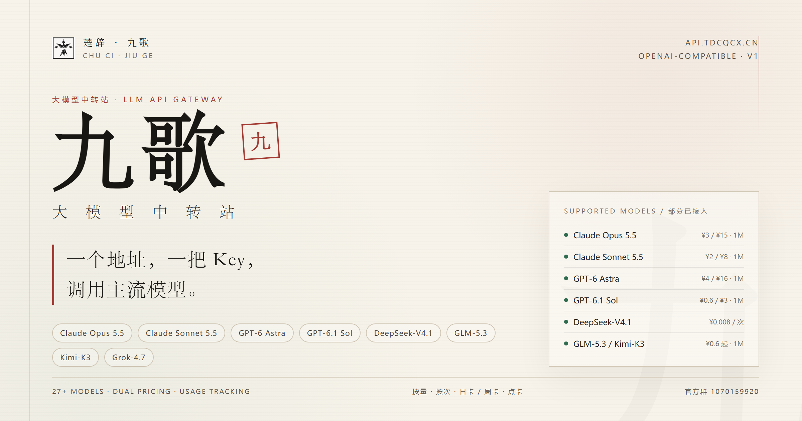
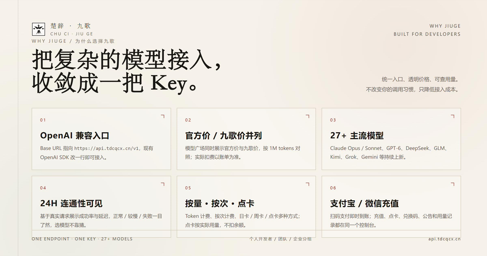
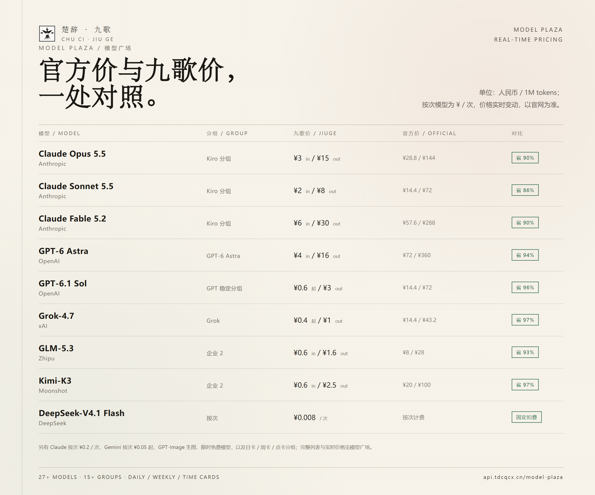
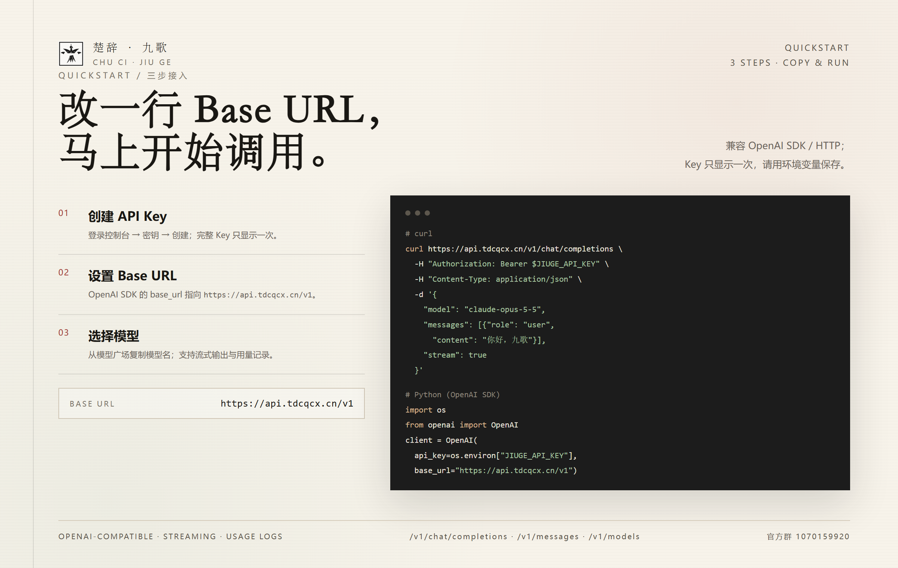

<div align="center">



# 九歌 API · JiuGe API

### 1 つのエンドポイント、1 つのキーで、主要モデルを。

**大規模言語モデル API 中継サービス · OpenAI-Compatible**

[公式サイト](https://api.tdcqcx.cn) · [モデル広場](https://api.tdcqcx.cn/model-plaza) · [接続ガイド](https://api.tdcqcx.cn/guide) · [新規登録](https://api.tdcqcx.cn/register) · [コンソール](https://api.tdcqcx.cn/dashboard)

[简体中文](README.md) | [English](README.en.md) | [日本語](README.ja.md)


</div>

---

## 九歌 API とは

**九歌 API（JiuGe API）** は、開発者向けのサードパーティ製 LLM API 中継・集約サービスです。OpenAI、Anthropic、Google、DeepSeek、智谱（Zhipu）、Moonshot、xAI などの主要モデルを、**1 つの Base URL と 1 つの API Key** にまとめます。既存の OpenAI SDK の使い方を大きく変える必要はありません。

- **統一エンドポイント：** `https://api.tdcqcx.cn/v1`
- **1 つのキー：** モデルごとに上流アカウントを管理する必要なし
- **価格の透明性：** 公式価格と九歌価格を 1M tokens 単位で並べて表示
- **利用量の確認：** 残高、リクエスト、Tokens、費用、キー別利用量
- **柔軟な課金：** 従量課金、リクエスト課金、日次 / 週次 / タイムカード、企業グループ
- **中国向け決済：** Alipay / WeChat Pay の QR 決済、通常は即時反映

> 九歌は独立したサードパーティ製 API 中継・集約サービスです。OpenAI、Anthropic、Google、DeepSeek、Zhipu、Moonshot、xAI 各社とは提携・代理関係にありません。モデル名および商標は各権利者に帰属します。

---

## 九歌を選ぶ理由



| 機能 | 内容 |
|---|---|
| **OpenAI 互換** | OpenAI SDK の `base_url` を変更するだけ。HTTP 直呼びも可能 |
| **主要モデル** | Claude Opus / Sonnet / Fable、GPT-6 / 6.1 / 6.2、DeepSeek-V4.1、GLM-5.3、Kimi-K3 / K3.1-Pro、Grok-4.7、Gemini など |
| **公式価格と九歌価格** | モデルごとに公式価格、九歌価格、節約率、キャッシュ価格を表示 |
| **24 時間の接続性** | 実際のリクエストに基づく成功率とレイテンシ |
| **複数の課金方式** | トークン従量、リクエスト課金、日次 / 週次 / タイムカード |
| **充実したコンソール** | キー、利用量、残高、チャージ、カード、引換コード、お知らせ、設定 |
| **決済** | Alipay / WeChat Pay の QR 決済、通常は即時反映 |
| **コミュニティ** | 公式 QQ グループ `1070159920` |

---

## モデルと価格



> 通貨は人民元（CNY）/ 1M tokens。リクエスト課金モデルは CNY / リクエストです。価格は上流チャネルや運営状況により変動します。**必ず[モデル広場](https://api.tdcqcx.cn/model-plaza)の最新価格を確認してください。** ドル建て公式価格は 1:7.2 で換算表示しています。

| モデル | プラットフォーム / グループ | 九歌価格（CNY / 1M） | 公式価格（CNY / 1M） | 備考 |
|---|---|---:|---:|---|
| **Claude Opus 5.5** | Anthropic / Kiro | 入力 3 · 出力 15 | 入力 28.8 · 出力 144 | 約 90% 安価 |
| **Claude Sonnet 5.5** | Anthropic / Kiro | 入力 2 · 出力 8 | 入力 14.4 · 出力 72 | 約 86% 安価 |
| **Claude Fable 5.2** | Anthropic / Kiro | 入力 6 · 出力 30 | 入力 57.6 · 出力 288 | 約 90% 安価 |
| **GPT-6 Astra** | OpenAI / GPT-6 Astra | 入力 4 · 出力 16 | 入力 72 · 出力 360 | 約 94% 安価 |
| **GPT-6.1 Sol** | OpenAI / GPT 安定 | 入力 0.6 〜 · 出力 3 | 入力 14.4 · 出力 72 | 約 96% 安価 |
| **Grok-4.7** | xAI / Grok | 入力 0.4 〜 · 出力 1 | 入力 14.4 · 出力 43.2 | 約 97% 安価 |
| **GLM-5.3** | Zhipu / 企業 2 | 入力 0.6 · 出力 1.6 | 入力 8 · 出力 28 | 約 93% 安価 |
| **Kimi-K3** | Moonshot / 企業 2 | 入力 0.6 · 出力 2.5 | 入力 20 · 出力 100 | 約 97% 安価 |
| **DeepSeek-V4.1 Flash** | DeepSeek / リクエスト課金 | **CNY 0.008 / 回** | リクエスト課金 | 固定課金 |

**その他の課金：**

- **リクエスト課金：** DeepSeek-V4.1 Flash CNY 0.008 / 回、Claude CNY 0.2 / 回、Gemini CNY 0.05 〜 / 回。
- **期間限定モデル：** Lunaroute プール 12 モデル、メインプール CNY 0.001 / 回〜、低速 / 不安定プール CNY 0.008 / 回。
- **画像生成：** GPT-Image シリーズ、リクエスト課金、`POST /v1/images/generations`。
- **日次 / 週次 / タイムカード：** グループ単位で購入、実利用量を消費、残高は減りません。期限切れで自動停止。
- **企業 / 低価格 GPT / 高キャッシュグループ：** チーム・バッチ処理向け。

---

## クイックスタート



### 1. API Key を作成

[コンソール](https://api.tdcqcx.cn/login)にログイン → **キー** → 作成。完全なキーは一度しか表示されないため、安全な場所に保存してください。

### 2. Base URL を設定

```text
https://api.tdcqcx.cn/v1
```

### 3. モデルを選んで呼び出す

[モデル広場](https://api.tdcqcx.cn/model-plaza)または[接続ガイド](https://api.tdcqcx.cn/guide)からモデル名をコピーします（例：`claude-opus-5-5`、`gpt-6-astra`、`deepseek-v4.1-flash-1017`）。

```bash
curl https://api.tdcqcx.cn/v1/chat/completions \
  -H "Authorization: Bearer $JIUGE_API_KEY" \
  -H "Content-Type: application/json" \
  -d '{
    "model": "claude-opus-5-5",
    "messages": [{"role": "user", "content": "こんにちは、九歌"}],
    "stream": true
  }'
```

**Python（OpenAI SDK）**

```python
import os
from openai import OpenAI

client = OpenAI(
    api_key=os.environ["JIUGE_API_KEY"],
    base_url="https://api.tdcqcx.cn/v1",
)

resp = client.chat.completions.create(
    model="claude-opus-5-5",
    messages=[{"role": "user", "content": "こんにちは、九歌"}],
    stream=True,
)
for chunk in resp:
    print(chunk.choices[0].delta.content or "", end="")
```

**Node.js（OpenAI SDK）**

```js
import OpenAI from "openai";

const client = new OpenAI({
  apiKey: process.env.JIUGE_API_KEY,
  baseURL: "https://api.tdcqcx.cn/v1",
});

const stream = await client.chat.completions.create({
  model: "gpt-6-astra",
  messages: [{ role: "user", content: "こんにちは、九歌" }],
  stream: true,
});
for await (const chunk of stream) {
  process.stdout.write(chunk.choices[0]?.delta?.content || "");
}
```

> キーは環境変数で渡してください。公開リポジトリ、フロントエンドコード、スクリーンショットに含めないでください。漏洩した場合はコンソールで削除し、再作成してください。

---

## コンソール

| ページ | できること |
|---|---|
| **ホーム / 概要** | 残高、リクエスト、費用、推移、モデルテスト結果 |
| **キー** | API Key の作成 / 削除、キー別利用量と上限 |
| **利用量** | Tokens / リクエストのグラフ、モデル・キー・期間で絞り込み |
| **モデル広場** | 公式価格と九歌価格、24 時間接続性、キャッシュ・段階価格 |
| **期間限定** | Lunaroute / Agent2API プール、リクエスト課金、画像モデル |
| **接続** | 3 ステップ、CURL / Python / Node.js サンプル、モデル一覧 |
| **チャージ** | Alipay / WeChat Pay、即時反映、履歴 |
| **タイムカード** | 日次 / 週次 / タイムカード、実利用量、残高を減らさない |
| **引換** | 引換コードで残高 / サブスクリプション |
| **お知らせ** | サイト上限、メンテナンス、運営通知 |
| **設定** | プロフィール、パスワード、通知 |

---

## 利用シーン

- **AI チャットボット / カスタマーサポート**：1 つの API で複数モデルを切り替え
- **AI エージェント / ツール呼び出し**：OpenAI 互換インターフェース
- **コーディング支援**：Claude、GPT、DeepSeek、GLM、Kimi を比較
- **コンテンツ生成 / コピーライティング / 翻訳**：従量課金でコスト管理
- **バッチ推論 / データラベリング**：リクエスト課金やタイムカード
- **モデル評価 / A-B テスト**：同じキーでモデルを切り替え
- **画像生成**：GPT-Image / Qwen-Image などをリクエスト課金で利用

---

## よくある質問

<details>
<summary><strong>九歌は公式 API ですか？</strong></summary>

いいえ。九歌は独立したサードパーティ製の LLM API 中継・集約サービスです。モデルベンダー各社との提携・代理関係はありません。モデル名・商標は各権利者に帰属します。
</details>

<details>
<summary><strong>OpenAI SDK では何を変更しますか？</strong></summary>

`base_url` を `https://api.tdcqcx.cn/v1` に、`api_key` を九歌のキーに変更します。ほとんどの OpenAI 互換 SDK / フレームワークはそのまま利用できます。
</details>

<details>
<summary><strong>対応 API は？</strong></summary>

`/v1/chat/completions`、`/v1/models` などの OpenAI 互換 API が中心です。Claude / Anthropic モデルも互換エンドポイント経由で利用できます。詳細は[接続ガイド](https://api.tdcqcx.cn/guide)を参照してください。
</details>

<details>
<summary><strong>なぜ公式より安いのですか？</strong></summary>

上流チャネル、プール、グループごとに価格が異なるためです。モデル広場に公式価格と九歌価格を並べて表示しています。価格・可用性は変動するため、購入前に最新ページを確認してください。
</details>

<details>
<summary><strong>支払い方法は？</strong></summary>

「チャージ」で Alipay / WeChat Pay、「タイムカード」で日次 / 週次 / タイムカードを購入できます。通常は即時反映されます。反映されない場合は「支払い完了」から照会してください。
</details>

<details>
<summary><strong>返金・同時接続数は？</strong></summary>

利用済み残高は返金できません。未利用分は管理者にご連絡ください。既定の同時接続数は 5 です。カードやグループによって上限が異なります。企業グループや高並列が必要な場合は公式グループでご相談ください。
</details>

<details>
<summary><strong>サポートは？</strong></summary>

公式 QQ グループ：**1070159920**。参加時に九歌のユーザー名をご記入ください。
</details>

---

## リンク

- 公式サイト / コンソール：<https://api.tdcqcx.cn>
- 新規登録：<https://api.tdcqcx.cn/register>
- ログイン：<https://api.tdcqcx.cn/login>
- モデル広場：<https://api.tdcqcx.cn/model-plaza>
- 接続ガイド：<https://api.tdcqcx.cn/guide>
- 期間限定モデル：<https://api.tdcqcx.cn/limited>
- チャージ：<https://api.tdcqcx.cn/recharge>
- タイムカード：<https://api.tdcqcx.cn/subscription>
- 公式 QQ グループ：`1070159920`

---

## 免責事項

九歌 API は独立したサードパーティ製の LLM API 中継・集約サービスであり、OpenAI、Anthropic、Google、DeepSeek、Zhipu、Moonshot、xAI 各社とは提携・代理関係にありません。モデル名、商標および関連権利は各権利者に帰属します。モデルの可用性、価格、レート制限、上流ポリシーは予告なく変更される場合があります。最新情報は公式サイトをご確認ください。本サービスを利用することで、適用法令、上流利用規約、サイトのお知らせを遵守することに同意したものとみなします。違法、権利侵害、詐欺、悪意のある攻撃、その他不適切な用途に使用しないでください。

---

<details>
<summary><strong>SEO キーワード / Keywords（クリックで展開）</strong></summary>

**日本語：** 九歌 API，JiuGe API，大規模言語モデル API，LLM API，LLM API 中継，AI API 中継，AI API ゲートウェイ，OpenAI 互換 API，OpenAI SDK，Claude API，Anthropic API，GPT-6 API，GPT-6 Astra，DeepSeek API，DeepSeek-V4.1，GLM-5.3，Kimi-K3，Kimi-K3.1-Pro，Grok-4.7，Gemini API，GPT-Image API，画像生成 API，テキスト生成 API，ストリーミング API，SSE，API キー管理，モデルマーケットプレイス，従量課金，リクエスト課金，トークン課金，デイリーチケット，ウィークリーチケット，タイムカード，Alipay，WeChat Pay，利用量分析，低コスト LLM API，安価な AI API，中国 AI API，開発者 API，AI チャットボット API，AI エージェント API，コード生成 API，コンテンツ生成 API，翻訳 API，バッチ推論，モデル比較，モデル評価，高並列 API，低遅延 API，安定した API 中継，企業向け API，無料モデル，期間限定無料モデル，中国 大規模言語モデル，API 中継サービス，OpenAI 互換 中継，Claude 中継，GPT 中継，DeepSeek 中継，GLM 中継，Kimi 中継，Grok 中継，Gemini 中継。

**English:** JiuGe API, LLM API gateway, AI API relay, OpenAI-compatible API, Claude API, GPT-6 API, DeepSeek API, GLM API, Kimi API, Grok API, Gemini API, cheap LLM API, pay-as-you-go, pay-per-request, streaming API, API key management, model marketplace, China AI API, developer API, AI chatbot API, AI agent API, coding assistant API, content generation API, translation API, batch inference, model comparison, high concurrency API, low latency API, enterprise API, free LLM API.

**中文：** 九歌API，九歌大模型中转站，大模型API中转，OpenAI兼容API，Claude API中转，GPT-6 API，DeepSeek API，GLM-5.3，Kimi-K3，Grok-4.7，Gemini API，按量计费，按次计费，日卡，周卡，点卡，支付宝充值，微信充值，模型广场，API Key管理，用量统计，企业分组，免费模型，tdcqcx，api.tdcqcx.cn。

</details>
