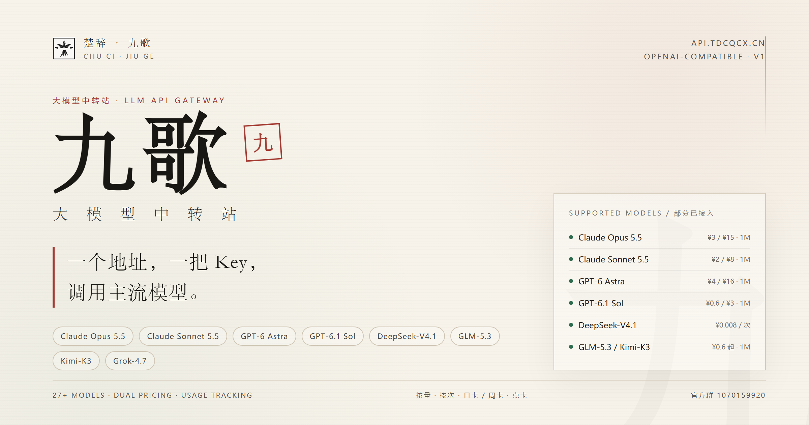
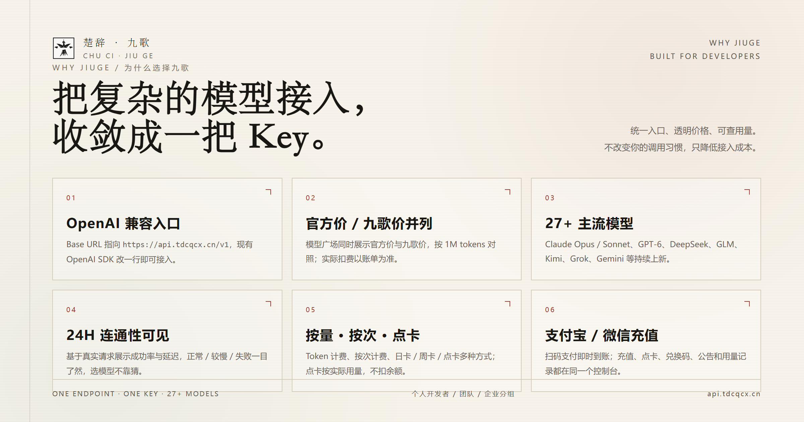
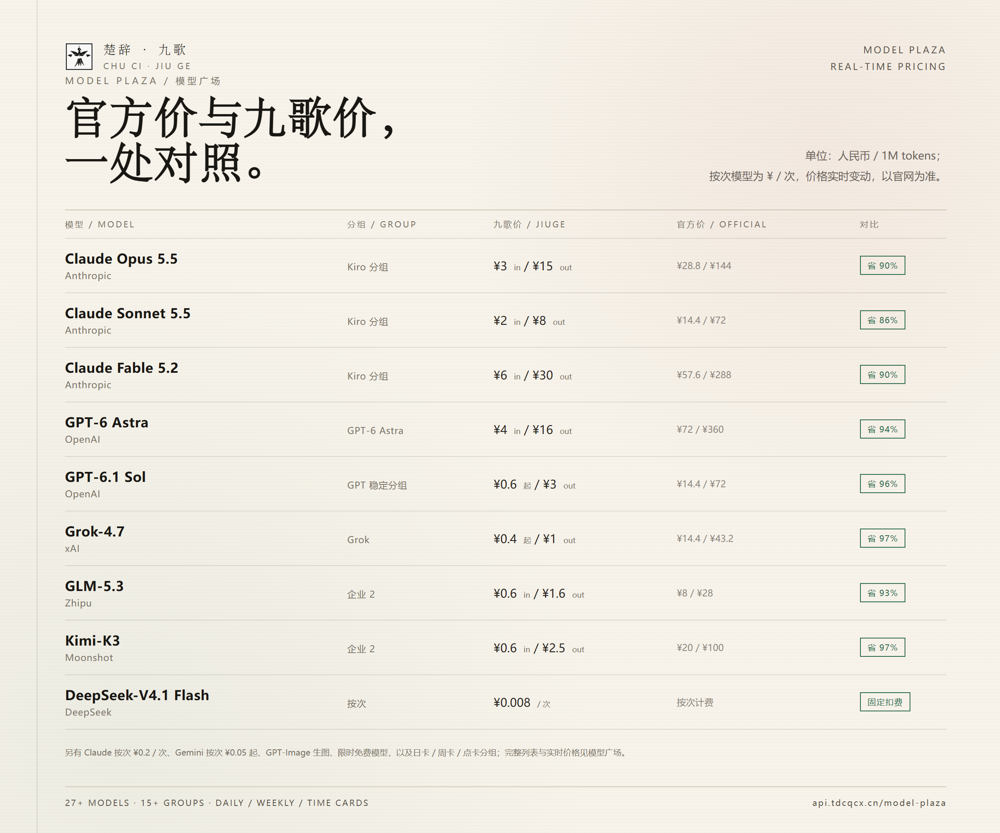
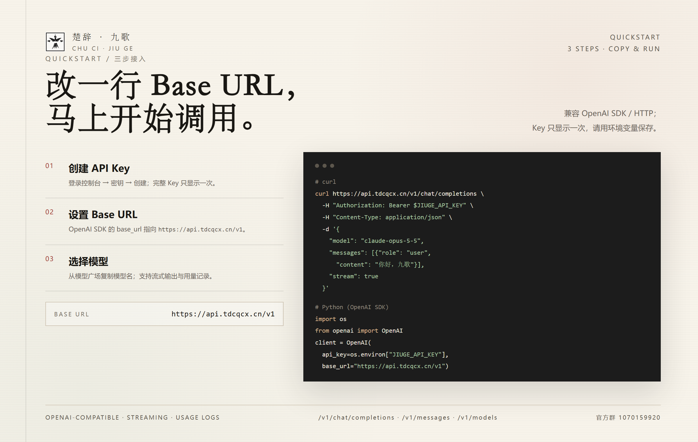

<div align="center">



# 九歌 API · JiuGe API

### 一个地址，一把 Key，调用主流模型。

**大模型中转站 · OpenAI-Compatible LLM API Gateway**

[官网](https://api.tdcqcx.cn) · [模型广场](https://api.tdcqcx.cn/model-plaza) · [接入指南](https://api.tdcqcx.cn/guide) · [注册](https://api.tdcqcx.cn/register) · [控制台](https://api.tdcqcx.cn/dashboard)

[简体中文](README.md) | [English](README.en.md) | [日本語](README.ja.md)


</div>

---

## 九歌是什么？

**九歌 API（JiuGe API）** 是面向开发者的大模型 API 中转与聚合服务。把 OpenAI、Anthropic、Google、DeepSeek、智谱、Moonshot、xAI 等主流模型系列收敛到**一个 Base URL、一把 API Key**，不改变你现有的 OpenAI SDK 调用习惯。

- **统一入口**：`https://api.tdcqcx.cn/v1`
- **一把 Key**：创建后即可切换不同模型，不需要为每个上游维护一套账号
- **双价透明**：模型广场同时展示官方价与九歌价，按 1M tokens 对照
- **用量可查**：余额、请求、Tokens、费用、Key 用量都在控制台
- **灵活计费**：按量、按次、日卡 / 周卡 / 点卡、企业分组
- **本地化支付**：支付宝 / 微信扫码充值，实时到账

> 九歌是第三方 API 中转/聚合服务，不隶属于 OpenAI、Anthropic、Google、DeepSeek、智谱、Moonshot、xAI 等模型厂商。模型名称与商标归各自权利人所有。

---

## 为什么选择九歌



| 能力 | 说明 |
|---|---|
| **OpenAI 兼容** | OpenAI SDK 只需改 `base_url`；也支持 HTTP 直接调用 |
| **主流模型覆盖** | Claude Opus / Sonnet / Fable、GPT-6 / GPT-6.1 / GPT-6.2、DeepSeek-V4.1、GLM-5.3、Kimi-K3 / K3.1-Pro、Grok-4.7、Gemini 等 |
| **官方价 / 九歌价并列** | 每个模型都能看到官方价、九歌价、节省比例与缓存价 |
| **24H 真实连通性** | 基于真实请求统计成功率与延迟，正常 / 较慢 / 失败一目了然 |
| **多种计费方式** | Token 按量、按次、日卡、周卡、点卡；点卡按实际用量，不扣余额 |
| **控制台完整** | 密钥、用量、余额、充值、点卡、兑换码、公告、设置 |
| **支付方便** | 支付宝 / 微信扫码，支付成功后余额通常即时到账 |
| **社区支持** | 官方 QQ 群 `1070159920`，使用交流、问题反馈、新模型通知 |

---

## 模型与价格



> 单位：人民币 / 1M tokens；按次模型为 ¥ / 次。价格为官网展示价，可能随渠道与运营调整，**以[模型广场](https://api.tdcqcx.cn/model-plaza)实时价格为准**。美元官方价按 1:7.2 折算展示。

| 模型 | 平台 / 分组 | 九歌价（¥ / 1M） | 官方价（¥ / 1M） | 备注 |
|---|---|---:|---:|---|
| **Claude Opus 5.5** | Anthropic / Kiro 分组 | 输入 3 · 输出 15 | 输入 28.8 · 输出 144 | 约省 90% |
| **Claude Sonnet 5.5** | Anthropic / Kiro 分组 | 输入 2 · 输出 8 | 输入 14.4 · 输出 72 | 约省 86% |
| **Claude Fable 5.2** | Anthropic / Kiro 分组 | 输入 6 · 输出 30 | 输入 57.6 · 输出 288 | 约省 90% |
| **GPT-6 Astra** | OpenAI / GPT-6 Astra | 输入 4 · 输出 16 | 输入 72 · 输出 360 | 约省 94% |
| **GPT-6.1 Sol** | OpenAI / GPT 稳定分组 | 输入 0.6 起 · 输出 3 | 输入 14.4 · 输出 72 | 约省 96% |
| **Grok-4.7** | xAI / Grok | 输入 0.4 起 · 输出 1 | 输入 14.4 · 输出 43.2 | 约省 97% |
| **GLM-5.3** | 智谱 / 企业 2 | 输入 0.6 · 输出 1.6 | 输入 8 · 输出 28 | 约省 93% |
| **Kimi-K3** | Moonshot / 企业 2 | 输入 0.6 · 输出 2.5 | 输入 20 · 输出 100 | 约省 97% |
| **DeepSeek-V4.1 Flash** | DeepSeek / 按次 | **¥0.008 / 次** | 按次计费 | 固定扣费 |

**更多计费方式：**

- **按次**：DeepSeek-V4.1 Flash ¥0.008 / 次；Claude 按次 ¥0.2 / 次；Gemini 按次 ¥0.05 起 / 次。
- **限时模型**：Lunaroute 号池 12 个模型，主号池 ¥0.001 / 次起，慢速 / 不稳定号池 ¥0.008 / 次。
- **生图模型**：GPT-Image 系列按次计费，使用 `POST /v1/images/generations`。
- **日卡 / 周卡 / 点卡**：按分组购买，按实际用量消耗，不扣账户余额；到期自动停止。
- **企业分组 / 低价 GPT / 高缓存分组**：面向团队与批量场景，具体价格见模型广场。

---

## 三步接入



### 1. 创建 API Key

登录 [控制台](https://api.tdcqcx.cn/login) → **密钥** → 创建 Key。完整 Key 只显示一次，请立即保存到密码管理器或环境变量。

### 2. 设置 Base URL

```text
https://api.tdcqcx.cn/v1
```

### 3. 选择模型并调用

模型名从[模型广场](https://api.tdcqcx.cn/model-plaza)或[接入指南](https://api.tdcqcx.cn/guide)复制，例如 `claude-opus-5-5`、`gpt-6-astra`、`deepseek-v4.1-flash-1017`。

```bash
curl https://api.tdcqcx.cn/v1/chat/completions \
  -H "Authorization: Bearer $JIUGE_API_KEY" \
  -H "Content-Type: application/json" \
  -d '{
    "model": "claude-opus-5-5",
    "messages": [{"role": "user", "content": "你好，九歌"}],
    "stream": true
  }'
```

**Python（OpenAI SDK）**

```python
import os
from openai import OpenAI

client = OpenAI(
    api_key=os.environ["JIUGE_API_KEY"],
    base_url="https://api.tdcqcx.cn/v1",
)

resp = client.chat.completions.create(
    model="claude-opus-5-5",
    messages=[{"role": "user", "content": "你好，九歌"}],
    stream=True,
)
for chunk in resp:
    print(chunk.choices[0].delta.content or "", end="")
```

**Node.js（OpenAI SDK）**

```js
import OpenAI from "openai";

const client = new OpenAI({
  apiKey: process.env.JIUGE_API_KEY,
  baseURL: "https://api.tdcqcx.cn/v1",
});

const stream = await client.chat.completions.create({
  model: "gpt-6-astra",
  messages: [{ role: "user", content: "你好，九歌" }],
  stream: true,
});
for await (const chunk of stream) {
  process.stdout.write(chunk.choices[0]?.delta?.content || "");
}
```

> Key 请通过环境变量传入；不要写入公开仓库、前端代码或截图。发现泄露请立即在控制台删除并重建。

---

## 控制台功能

| 页面 | 能做什么 |
|---|---|
| **主页 / 总览** | 余额、请求、费用、趋势、鹈鹕测试结果 |
| **密钥** | 创建 / 删除 API Key、查看 Key 用量与限额 |
| **用量** | Tokens / 请求双轴图表、按模型 / Key / 时间筛选 |
| **模型广场** | 官方价 vs 九歌价、24H 连通性、缓存价、阶梯价 |
| **限时模型** | Lunaroute / Agent2API 号池，按次计费，图像模型 |
| **接入** | 三步教程、CURL / Python / Node.js 示例、模型列表 |
| **充值** | 支付宝 / 微信扫码，实时到账，充值记录 |
| **点卡** | 日卡 / 周卡 / 点卡，按实际用量，不扣余额 |
| **兑换** | 兑换码兑换余额 / 订阅 |
| **公告** | 站点上限、维护、运行通知 |
| **设置** | 个人资料、密码、通知等 |

---

## 适用场景

- **AI 聊天机器人 / 智能客服**：统一接入多家模型，按场景切换
- **AI Agent / 工具调用**：同一套 OpenAI 兼容接口，便于框架适配
- **代码助手 / 编程 Agent**：Claude、GPT、DeepSeek、GLM、Kimi 多模型对比
- **内容生成 / 文案 / 翻译**：按量计费，成本可控
- **批量推理 / 数据标注**：按次或点卡，适合高吞吐任务
- **模型评测 / A-B 测试**：同一 Key 切换模型，快速比较质量、延迟与价格
- **图像生成**：GPT-Image / Qwen-Image 等模型按次调用

---

## 常见问题

<details>
<summary><strong>九歌是官方 API 吗？</strong></summary>

不是。九歌是第三方大模型 API 中转/聚合服务，不隶属于任何模型厂商。模型名称、商标和服务归各自权利人所有。九歌提供统一入口、计费、用量和运维能力。
</details>

<details>
<summary><strong>现有 OpenAI SDK 需要改什么？</strong></summary>

只需要把 `base_url` 改成 `https://api.tdcqcx.cn/v1`，把 `api_key` 换成九歌 Key；模型名从模型广场复制。大多数 OpenAI SDK / 框架无需改代码。
</details>

<details>
<summary><strong>支持哪些协议和接口？</strong></summary>

以 OpenAI 兼容接口为主，支持 `/v1/chat/completions`、`/v1/models` 等；Claude / Anthropic 模型也可通过兼容接口调用。具体以[接入指南](https://api.tdcqcx.cn/guide)为准。
</details>

<details>
<summary><strong>价格为什么比官方低？</strong></summary>

九歌通过不同上游渠道、号池和分组提供多种价格；模型广场会同时展示官方价与九歌价。价格和可用性会随渠道状态调整，下单前请以页面实时价格为准。
</details>

<details>
<summary><strong>怎么充值、买点卡？</strong></summary>

控制台「充值」支持支付宝 / 微信扫码；「点卡」支持日卡 / 周卡 / 点卡。支付成功后通常即时到账；如未更新，可点「我已完成支付」主动查单。
</details>

<details>
<summary><strong>可以退款吗？</strong></summary>

已消耗额度不支持退款；未消耗部分请联系管理员处理。具体以站点公告和客服说明为准。
</details>

<details>
<summary><strong>并发和限流是多少？</strong></summary>

默认账号并发为 5，点卡 / 分组可能提供更高并发；高峰期号池可能需要排队。需要更高并发或企业分组，请进官方群联系管理员。
</details>

<details>
<summary><strong>Key 泄露了怎么办？</strong></summary>

立即在控制台删除该 Key 并创建新 Key；检查用量记录；不要把 Key 写入公开仓库、前端代码或截图。
</details>

<details>
<summary><strong>怎么获取帮助？</strong></summary>

官方 QQ 群：**1070159920**（使用交流、问题反馈、新模型通知）。加群请备注九歌用户名，方便核对账号。
</details>

---

## 链接

- 官网 / 控制台：<https://api.tdcqcx.cn>
- 注册：<https://api.tdcqcx.cn/register>
- 登录：<https://api.tdcqcx.cn/login>
- 模型广场：<https://api.tdcqcx.cn/model-plaza>
- 接入指南：<https://api.tdcqcx.cn/guide>
- 限时模型：<https://api.tdcqcx.cn/limited>
- 充值：<https://api.tdcqcx.cn/recharge>
- 点卡：<https://api.tdcqcx.cn/subscription>
- 官方 QQ 群：`1070159920`

---

## 免责声明

九歌 API 是第三方大模型 API 中转/聚合服务，与 OpenAI、Anthropic、Google、DeepSeek、智谱、Moonshot、xAI 等模型厂商无隶属或代理关系。模型名称、商标及相关权利归各自权利人所有。模型可用性、价格、速率限制和上游策略可能随时调整，请以官网实时展示为准。使用本服务即表示你同意遵守所在地法律法规、上游服务条款及站点公告；请勿将服务用于违法、侵权、欺诈、恶意攻击或其他不当用途。

---

<details>
<summary><strong>SEO 关键词 / Keywords（点击展开）</strong></summary>

**中文核心词：** 九歌API，九歌 API，九歌大模型中转站，九歌中转站，九歌控制台，大模型API，大模型API中转，大模型API代理，AI API中转，AI API代理，AI API聚合，大模型聚合，LLM API，LLM API Gateway，AI Gateway，OpenAI API中转，OpenAI兼容API，OpenAI SDK，Claude API，Claude API中转，Anthropic API，GPT-6 API，GPT-6 Astra，GPT-6.1 Sol，GPT-6.2 Sol，GPT-6.2 Astra，DeepSeek API，DeepSeek-V4.1，DeepSeek-V4.1-Flash，GLM-5.3，GLM-5.3-Flash，GLM-5.3-FlashX，Kimi-K3，Kimi-K3.1-Pro，Grok-4.7，Gemini API，Gemini 3.8 Flash，Gemini 4 Argon，GPT-Image，生图API，图像生成API，文本生成API，流式输出，SSE，API Key管理，模型广场，官方价对比，九歌价，按量计费，按次计费，Token计费，日卡，周卡，点卡，订阅卡，支付宝充值，微信充值，兑换码，用量统计，余额查询，并发，高并发API，低延迟API，稳定中转，国内API，中国AI API，开发者API，AI应用接入，聊天机器人API，智能客服API，AI Agent，代码助手API，编程助手API，内容生成API，文案生成API，翻译API，批量推理，模型对比，模型评测，API代理，API聚合，低价API，便宜API，免费模型，限时免费，企业API，企业分组，低价GPT，高缓存模型，Claude Opus 5.5，Claude Sonnet 5.5，Claude Fable 5.2，tdcqcx，api.tdcqcx.cn。

**中文长尾词：** 国内大模型API中转站，OpenAI兼容的大模型API，Claude API国内中转，GPT-6 API低价，DeepSeek API按次计费，GLM-5.3 API价格，Kimi-K3 API接入，Grok-4.7 API中转，Gemini API按次，GPT-Image生图API，大模型API按量计费，大模型API按次计费，大模型日卡，大模型周卡，大模型点卡，AI API支付宝充值，AI API微信充值，OpenAI SDK base_url 修改，Python OpenAI SDK 接入，Node.js OpenAI SDK 接入，AI聊天机器人API接入，AI Agent工具调用API，代码助手API接入，批量文本生成API，多模型A/B测试，模型价格对比，API Key安全，API Key轮换，大模型API并发，大模型API限流，大模型API延迟，大模型API成功率，九歌官方群。

**English：** JiuGe API, JiuGe LLM API, JiuGe API gateway, LLM API gateway, AI API gateway, AI API relay, AI API proxy, OpenAI-compatible API, OpenAI API proxy, OpenAI SDK, Claude API, Claude API proxy, Anthropic API, GPT-6 API, GPT-6 Astra, GPT-6.1 Sol, GPT-6.2 Sol, DeepSeek API, DeepSeek-V4.1, GLM-5.3, Kimi-K3, Kimi-K3.1-Pro, Grok-4.7, Gemini API, GPT-Image API, image generation API, text generation API, streaming API, SSE API, API key management, model marketplace, dual pricing, pay-as-you-go, pay-per-token, pay-per-request, daily card, weekly card, time card, Alipay, WeChat Pay, usage analytics, low-cost LLM API, cheap AI API, China AI API, developer API, AI chatbot API, AI agent API, coding assistant API, content generation API, translation API, batch inference, model comparison, model evaluation, high concurrency API, low latency API, stable API relay, enterprise API, free LLM API, limited-time free models.

**日本語：** 九歌 API，JiuGe API，大規模言語モデル API，LLM API，LLM API 中継，AI API 中継，AI API ゲートウェイ，OpenAI 互換 API，OpenAI SDK，Claude API，Anthropic API，GPT-6 API，GPT-6 Astra，DeepSeek API，DeepSeek-V4.1，GLM-5.3，Kimi-K3，Kimi-K3.1-Pro，Grok-4.7，Gemini API，GPT-Image API，画像生成 API，テキスト生成 API，ストリーミング API，SSE，API キー管理，モデルマーケットプレイス，従量課金，リクエスト課金，トークン課金，デイリーチケット，ウィークリーチケット，タイムカード，Alipay，WeChat Pay，利用量分析，低コスト LLM API，安価な AI API，中国 AI API，開発者 API，AI チャットボット API，AI エージェント API，コード生成 API，コンテンツ生成 API，翻訳 API，バッチ推論，モデル比較，モデル評価，高並列 API，低遅延 API，安定した API 中継，企業向け API，無料モデル，期間限定無料モデル。

</details>
